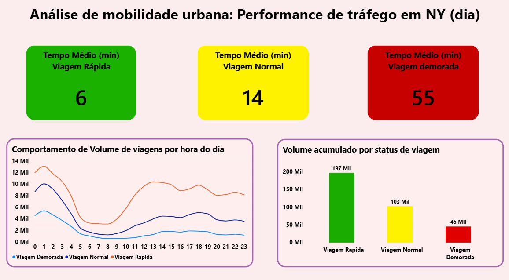
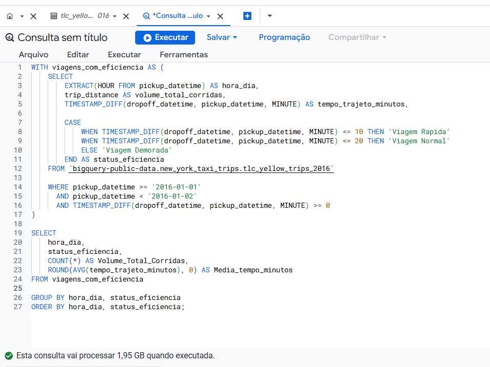
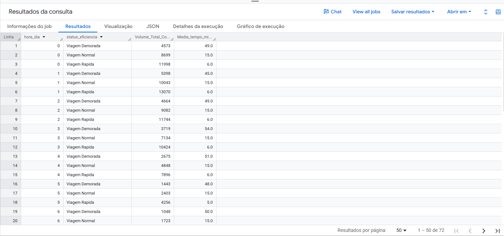

Análise de Mobilidade Urbana: Performance de Tráfego Diário em NY

Este projeto foi desenvolvido para analisar o histórico de transporte urbano e classificar a eficiência operacional das viagens por faixas de tempo de trajeto. Através da mineração de dados massivos na nuvem e da criação de regras de negócio condicionais, o projeto entrega um diagnóstico completo de volumetria total e médias operacionais diárias orientadas à tomada de decisão executiva.

Contexto e Desafio de Negócio
Em grandes operações de mobilidade urbana e marketplaces de transporte, o controle do Tempo Médio de Deslocamento (Trip Duration) e o monitoramento de SLAs são fundamentais para otimizar frotas, ajustar tarifas dinâmicas e garantir a satisfação do cliente final.
O objetivo deste projeto foi responder a perguntas operacionais estratégicas sobre o comportamento do tráfego urbano:

1. Qual é o volume diário de viagens consolidadas por faixas de eficiência?
2. Qual é o tempo médio gasto pelos passageiros em cada uma dessas faixas?
3. Quais horários do dia concentram os maiores picos de tráfego e gargalos operacionais?
Arquitetura e Engenharia de Dados
Para garantir a governança e tratar os dados direto na origem, toda a lógica de negócio foi processada em nuvem utilizando SQL Avançado no ambiente Google BigQuery. A fonte utilizada foi a tabela bigquery-public-data.new_york_taxi_trips.tlc_yellow_trips_2016, que se trata de um dataset público, real e massivo de corridas de táxis.
Técnicas Avançadas Aplicadas no SQL:
• Common Table Expressions (CTEs): Uso de cláusula WITH para isolar e preparar as variáveis antes da agregação final, garantindo a legibilidade e a performance do código.
• Inteligência Condicional (CASE WHEN): Classificação automática das viagens em 3 níveis operacionais com base na duração em minutos (TIMESTAMP_DIFF):
	• Viagem Rápida: Até 10 minutos de trajeto.
	• Viagem Normal: De 11 a 20 minutos de trajeto.
	• Viagem com Atraso: Acima de 20 minutos de trajeto.
• Data Wrangling de Segurança: Inclusão de filtros de qualidade para expurgar registros corrompidos com tempos negativos no trânsito (>= 0).
• Tratamento Matemático na Origem: Uso da função ROUND(AVG(...), 0) para entregar as médias operacionais já tratadas em minutos inteinos.

Código SQL Desenvolvido
WITH viagens_com_eficiencia AS (
SELECT
EXTRACT(HOUR FROM pickup_datetime) AS hora_dia,
trip_distance AS volume_total_corridas,
TIMESTAMP_DIFF(dropoff_datetime, pickup_datetime, MINUTE) AS tempo_trajeto_minutos,
CASE
WHEN TIMESTAMP_DIFF(dropoff_datetime, pickup_datetime, MINUTE) <= 10 THEN 'Viagem Rapida'
WHEN TIMESTAMP_DIFF(dropoff_datetime, pickup_datetime, MINUTE) <= 20 THEN 'Viagem Normal'
ELSE 'Viagem com Atraso'
END AS status_eficiencia
FROM bigquery-public-data.new_york_taxi_trips.tlc_yellow_trips_2016
WHERE pickup_datetime >= '2016-01-01'
AND pickup_datetime < '2016-01-02'
AND TIMESTAMP_DIFF(dropoff_datetime, pickup_datetime, MINUTE) >= 0
)
SELECT
hora_dia,
status_eficiencia,
COUNT(*) AS Volume_Total_Corridas,
ROUND(AVG(tempo_trajeto_minutos), 0) AS Media_tempo_minutos
FROM viagens_com_eficiencia
GROUP BY hora_dia, status_eficiencia
ORDER BY hora_dia, status_eficiencia;

Visualização de Dados (Power BI)
Os dados processados na nuvem foram importados via consulta direta para o Power BI Desktop, onde foi construído um dashboard executivo seguindo os mais altos padrões estéticos e de Data Storytelling do mercado.
Imagens do Portfólio:
1. Dashboard Executivo Finalizado

2. Ambiente de Desenvolvimento SQL (Google BigQuery)

3. Auditoria e Validação das 72 Linhas Geradas

Diferenciais do Design Aplicado:
• Layout Limpo: Eliminação completa de textos de sistema vazios e rótulos redundantes de eixos, priorizando os Rótulos de Dados sobre as colunas para acelerar a leitura executiva.
• Semáforo Visual Coerente: Sincronização cromática total entre os cartões de KPI superiores e os gráficos inferiores (Verde para Rápido, Amarelo para Padrão e Vermelho para Demorado).
• Análise em Camadas: O painel exibe de forma clara os indicadores macros agregados do dia ao mesmo tempo que permite descer ao nível de detalhe analítico através das curvas de linhas horárias.

Análise Estratégica dos Resultados Operacionais — Impacto do Pico de Ano Novo em NY.
A análise combinada entre a volumetria total e as curvas horárias de tráfego permitiu identificar os seguintes padrões operacionais no conjunto de dados, considerando especificamente o cenário real do dia 1º de janeiro em Nova York:

1. O Gargalo Atípico da Madrugada (Pico de Ano Novo à 1h da Manhã)
O gráfico de linhas revela um comportamento altamente atípico: um pico severo de Viagens Demoradas logo à 1h00 da manhã. Em um dia convencional, a madrugada apresentaria trânsito totalmente livre, mas este registro reflete o primeiro dia do ano. Na madrugada de Ano Novo, a dispersão em massa do público de grandes eventos combinada com bloqueios de segurança nas vias geram um colapso temporário no fluxo. A demanda explode simultaneamente, fazendo com que o tempo médio de viagem suba substancialmente logo no início do dia.

2. Concentração de Gargalos no Horário de Pico Comercial (Janela das 14h às 19h)
Após a normalização do tráfego da madrugada, o segundo grande movimento de retenção ocorre entre as 14h00 e as 19h00. Esse comportamento é diretamente proporcional ao aumento do fluxo de veículos nas ruas ao longo da tarde e término do horário comercial. Para a gestão da frota, essa janela representa o maior desafio de SLA do dia, onde o congestionamento urbano severo dita o ritmo das viagens.

3. Fluidez Máxima e Vales Operacionais (Início da Manhã)
Entre as 05h00 e as 09h00 da manhã, a operação atinge o seu nível máximo de eficiência. Por ser feriado de Ano Novo, a cidade desperta mais tarde e o volume absoluto de carros circulando desaba. Com as ruas limpas, a grande maioria das corridas é concluída sem nenhuma retenção, mantendo a média geral do período em valores baixos e controlados.

4. Recomendação para Tomada de Decisão (Ações de Negócio baseadas no Diagnóstico)
Com base nesse diagnóstico de sazonalidade, uma liderança de operações de mobilidade urbana poderia adotar duas ações estratégicas:
• Planejamento preditivo de frotas específico para a madrugada de grandes eventos (como o Réveillon), ajustando rotas e orientando motoristas sobre bloqueios.
• Implementação de tarifas dinâmicas agressivas na janela comercial da tarde (14h às 19h) para balancear a oferta de carros nas zonas de alta retenção.

Ferramentas Utilizadas
• Google BigQuery (Nuvem de dados e propriedades SQL)
• Microsoft Power BI (Tratamento complementar de eixos, design e Data Storytelling)
• Git e GitHub (Versionamento de código e portfólio)

